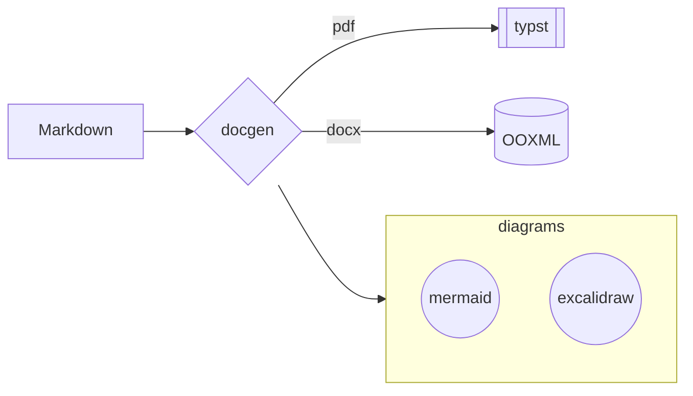
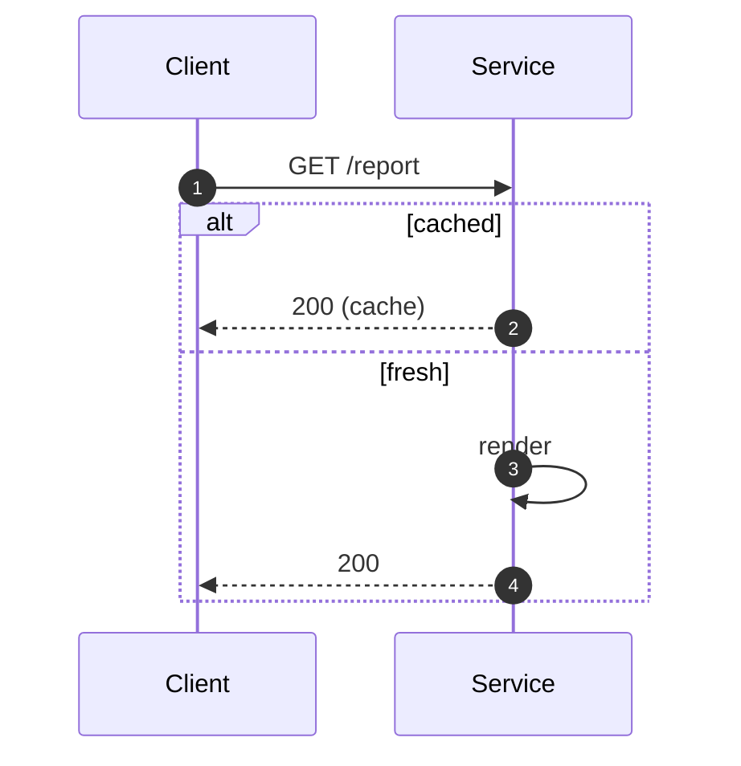
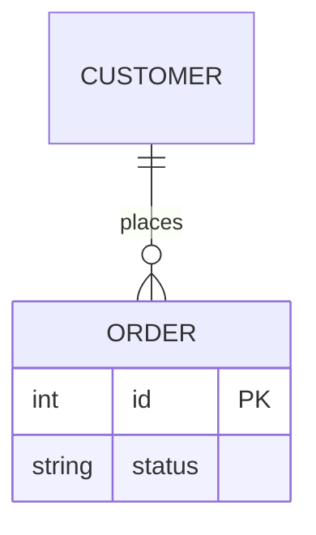
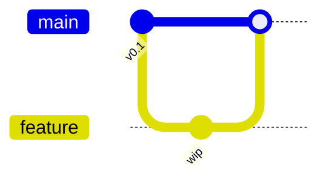
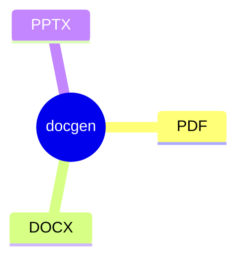

# Mermaid primer

Mermaid fenced blocks (and standalone `.mmd` files) render natively — no
browser, no JavaScript. Syntax follows **mermaid 12**. The table below is
verified against the shipped binary; every snippet here renders.

Read this when embedding diagrams. Integration (captions, ids, sizing,
which formats embed which image type) is at the end.

## Supported diagram types

| Type | First line | Notes |
|---|---|---|
| Flowchart | `flowchart TD` (also `graph`) | the workhorse; subgraphs, all shapes, labeled edges, `flowchart-elk` variant for stronger layout |
| Sequence | `sequenceDiagram` | participants, arrows (`->>`, `-->>`), `autonumber`, `note over` |
| Class | `classDiagram` | members, generics, relations (`<|--`, `*--`, `o--`) |
| State | `stateDiagram-v2` | transitions, nested/composite states |
| ER | `erDiagram` | crow's-foot relations, attribute blocks with PK/FK |
| User journey | `journey` | sections, scored tasks |
| Gantt | `gantt` | `dateFormat`, sections, tasks, `after` dependencies |
| Pie | `pie` | `title`, label/value pairs |
| Quadrant | `quadrantChart` | axes, plotted points |
| Requirement | `requirementDiagram` | requirement/element blocks, trace relationships |
| Git graph | `gitGraph` | commits, branches, merges (`merge dev`) |
| Mindmap | `mindmap` | indentation defines the tree |
| Timeline | `timeline` | periods and events |
| ZenUML | `zenuml` | code-style sequence diagrams |
| Sankey | `sankey-beta` | CSV-like `source,target,value` lines |
| XY chart | `xychart-beta` | `bar`/`line` series over an x-axis |
| Block | `block-beta` | schematic layouts with explicit `columns` |
| Packet | `packet-beta` | bit-field diagrams |
| Kanban | `kanban` | columns and cards (indentation-based) |
| Radar | `radar-beta` | axes, curves, `max` |
| C4 | `C4Context` (+ C4 family) | persons, systems, `Rel` |

**Not supported:** `architecture-beta` (fails the render). Prefer a
flowchart or an excalidraw scene for deployment-style pictures.

## Snippets











The other types follow mermaid 12 syntax exactly as documented on
mermaid.js.org — the table above gives the declaration line for each.

## docgen integration details

**Labels are native SVG text.** docgen prepends
`%%{init: {"htmlLabels": false}}%%` unless the source already starts
with its own `%%{init …}%%` directive. HTML/`<foreignObject>` labels are
dropped by browserless SVG consumers, so:

- plain-text labels just work;
- if you supply your own `%%{init}%%`, include `"htmlLabels": false`
  yourself — otherwise labels disappear in PDF output.

**Math labels** (`A["$$x^2$$"]`) are kept as **literal text**, not
typeset: mermaid's math path renders KaTeX into HTML labels, which the
browserless pipeline cannot consume (with `htmlLabels: true` the formula
is dropped entirely). Write such labels as plain text (`x^2`, `E = mc^2`)
until merman grows a browserless math lowering.

**Edge-label plates** are opaque white by default so the edge line does
not strike through label text on white pages. (Library hosts can choose
transparent/colored plates for tinted template backgrounds; the CLI uses
white.)

**PNG rasters** use the embedded Libertinus/DejaVu font set (the same
fonts the PDF engine embeds), so label text renders identically on
machines with no installed fonts — including the wasm/browserless
component, whose raster font database would otherwise be empty.

**Captions, ids, figures**: fence attributes apply as everywhere —
```` ```mermaid {#fig:arch caption="System architecture"} place=appendix ````
makes the diagram a numbered, linkable figure (`#fig:arch` /
`#fig-arch`), optionally appendix-placed.

**Sizing**: diagrams fit the page content box (width and height) with a
warning below 50% scale — restructure very wide diagrams (flowchart
`TD` instead of `LR`, or split) rather than letting them shrink to
unreadable text.

**Embedding by format**: PDF embeds the SVG (crisp at any zoom); DOCX
and PPTX embed rasterized PNG. PPTX diagrams are centered images on the
slide.

**Determinism**: the same source renders byte-identical output — safe
to diff, safe to golden-test, stable across machines.

## Authoring tips

- Pick direction deliberately: `TD` for hierarchies, `LR` for pipelines.
  Very wide `LR` chains are the usual cause of shrink warnings.
- Keep edge labels short; they sit on the line with a white plate.
- Subgraphs cluster related nodes and give the layout engine freedom —
  prefer them over invisible spacer nodes.
- Style/theme options (`classDef`, `style`, `themeVariables`) follow
  mermaid 12 defaults; verify visually after rendering — browser-only
  effects are the ones most likely to degrade headlessly.
