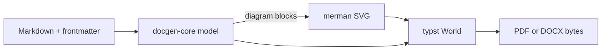

# Overview {#overview}

This document exercises every block kind the docgen pipeline currently
supports: headings, paragraphs with **bold**, _italics_, `inline code` and
[links](https://example.com), lists, tables, code blocks and **mermaid
diagrams rendered natively in Rust**. This revision tweaks the overview
wording to demonstrate word-level tracked changes.

## Architecture {#architecture}

The diagram below is rendered by the headless `merman` engine, embedded as an
SVG into the typst world, and laid out on the page — no browser, no Node.



## Blocks {#blocks}

1. Parsing keeps stable ids for structural diffing
2. Diagrams render through the `DiagramRenderer` trait
3. Typst compiles from an in-memory world
4. Word output carries native tracked changes

- no filesystem in the libraries
- deterministic output, no clocks

## Code {#code}

```rust
let doc = docgen_core::parse_document(&markdown)?;
let outcome = docgen_core::assets::render_diagrams(&doc, &MermaidRenderer::new())?;
let (pdf, warnings) = TypstRenderer::new_embedded().render_pdf(&doc, &outcome.assets)?;
```

## Status {#status}

| Component | Engine | Status |
|-----------|--------|--------|
| Markdown + YAML | pulldown-cmark, serde_yaml_ng | working |
| Mermaid → SVG/PNG | merman | working |
| PDF | typst (embedded world) | working |
| DOCX / diff | OOXML writer + w:ins/w:del | working |
| PPTX | OOXML writer | planned |
| Excalidraw | native renderer | planned |

## New in this revision {#new-in-this-revision}

Freshly added section: structural diffing lands in M2, with fuzzy pairing of
edited paragraphs and comments on moved blocks.

---

End of sample.
